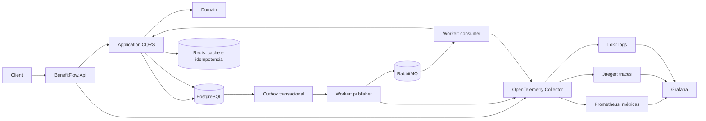

# BenefitFlow

API de reserva e processamento assíncrono de benefícios de saúde, construída com .NET 8, Clean Architecture e DDD. O exemplo demonstra idempotência, consistência concorrente, Outbox transacional, mensageria, cache, resiliência e observabilidade.

> Os valores do Docker Compose e o beneficiário seed são exclusivamente para demonstração local. Configure credenciais, TLS, políticas de rede, retenção e gestão de segredos antes de qualquer uso fora de desenvolvimento.

## Arquitetura



```text
src/
  BenefitFlow.Domain/        Agregados, value objects, invariantes, eventos e Result
  BenefitFlow.Application/   CQRS, handlers, validação, contratos e métricas
  BenefitFlow.Infrastructure/EF Core, Postgres, Redis, Outbox, Polly e OpenTelemetry
  BenefitFlow.Api/           REST versionada, ProblemDetails e health checks
  BenefitFlow.Worker/        Publisher, consumidor MassTransit e expiração
tests/
  BenefitFlow.Domain.UnitTests/
  BenefitFlow.Application.UnitTests/
  BenefitFlow.IntegrationTests/
  load/reservations.js
deploy/                      Collector, Prometheus, Loki e provisionamento Grafana
```

## Fluxo de reserva

1. `POST /api/v1/reservations` valida o comando, exige `Idempotency-Key` e grava a reserva `Pending` e seu evento de domínio na mesma transação PostgreSQL.
2. Um publisher do Worker usa `FOR UPDATE SKIP LOCKED` para ler a Outbox e publicar no RabbitMQ. Se a publicação falhar, a mensagem permanece pendente; o fluxo é at-least-once.
3. O consumidor registra o ID da mensagem processada no Postgres e executa o comando de processamento. Reservas confirmadas debitam o saldo; elegibilidade ou saldo insuficiente rejeitam a reserva.
4. Os consumidores deduplicam pelo ID do Outbox e a criação usa cache Redis de idempotência com o índice único do Postgres como autoridade. Se Redis falhar, leituras seguem pelo banco.
5. Um job no Worker encontra reservas pendentes vencidas e executa a transição para `Expired`. O saldo só é alterado no processamento bem-sucedido; cancelamento de reserva confirmada devolve o valor.

O saldo usa concorrência otimista via `xmin` do PostgreSQL. Em conflito, uma das gravações é recusada; o consumo de mensagens é repetido pelo MassTransit. A garantia de idempotência no banco evita que a entrega at-least-once altere o saldo duas vezes.

## API

Base URL: `http://localhost:8080`

| Método | Rota | Descrição |
|---|---|---|
| `POST` | `/api/v1/reservations` | Cria uma reserva pendente; requer `Idempotency-Key`; responde `202 Accepted` e `Location`. |
| `GET` | `/api/v1/reservations/{id}` | Consulta estado atual; cache-aside com TTL curto. |
| `POST` | `/api/v1/reservations/{id}/cancel` | Cancela uma reserva confirmada e devolve o saldo. |
| `GET` | `/api/v1/beneficiaries/{id}/balance?benefitType=Consultation` | Consulta saldo por tipo de benefício. |
| `GET` | `/health/live` | Liveness do processo. |
| `GET` | `/health/ready` | Readiness: PostgreSQL, Redis e porta do RabbitMQ. |
| `GET` | `/swagger` | Swagger UI em ambiente Development. |

Exemplo:

```bash
curl -i http://localhost:8080/api/v1/reservations \
  -H "Content-Type: application/json" \
  -H "Idempotency-Key: demo-reservation-001" \
  -d '{
    "beneficiaryId": "f87d30ea-8806-4e18-b292-0e03a52178dd",
    "benefitType": "Consultation",
    "amount": 25.00,
    "currency": "BRL"
  }'
```

O corpo seed usa um CPF válido de demonstração (`52998224725`) e saldo inicial de `BRL 500.00` para `Consultation`.

## Subir a infraestrutura

Requisitos: Docker Desktop / Docker Engine com Compose. Na raiz do repositório:

```bash
docker compose up --build -d
docker compose ps
```

O Compose aplica migrations e cria os dados de demonstração no primeiro start. O seed é idempotente enquanto existir ao menos um beneficiário.

| Serviço | Endereço local | Uso |
|---|---|---|
| API | [http://localhost:8080](http://localhost:8080) | REST e Swagger |
| Grafana | [http://localhost:3000](http://localhost:3000) | usuário `admin`, senha `benefitflow-dev`; dashboard BenefitFlow provisionado |
| Jaeger | [http://localhost:16686](http://localhost:16686) | traces distribuídos |
| Prometheus | [http://localhost:9090](http://localhost:9090) | métricas |
| Loki | [http://localhost:3100](http://localhost:3100) | logs |
| RabbitMQ Management | [http://localhost:15672](http://localhost:15672) | usuário `benefitflow`, senha `benefitflow-dev` |
| PostgreSQL | `localhost:5432` | database `benefitflow` |
| Redis | `localhost:6379` | cache |

Parar sem remover volumes:

```bash
docker compose down
```

Para reiniciar o cenário de carga com o saldo seed intacto, remova somente os volumes nomeados do Compose:

```bash
docker compose down --volumes
docker compose up --build -d
```

## Resiliência e observabilidade

- Polly: timeout, retry exponencial com jitter e circuit breaker em Redis, elegibilidade HTTP simulada e publicação no RabbitMQ. `Eligibility:FailFirstRequests` injeta falhas transitórias para demonstração.
- Redis: cache-aside e idempotência; falhas Redis são registradas e a fonte de verdade permanece no Postgres.
- API: rate limit fixo de 100 criações por minuto; `429 Too Many Requests` quando excedido.
- Worker: retry exponencial de mensagens e Dead Letter Queue pelo transporte RabbitMQ; encerramento cooperativo com `CancellationToken`.
- Métricas customizadas: `reservations_created_total`, `reservations_confirmed_total`, `reservations_rejected_total`, `reservation_processing_duration_seconds`, `outbox_pending_messages`, `cache_hits_total`, `cache_misses_total`, `rabbitmq_queue_messages` e `circuit_breaker_state`.
- Traces: ASP.NET Core, HttpClient, EF Core/Npgsql, operações Redis instrumentadas no wrapper, MassTransit e publisher da Outbox. O `traceparent`/`tracestate` é persistido junto ao evento para atravessar o período entre a requisição HTTP e a publicação assíncrona.
- Logs: Serilog em JSON compacto no console e exportação OTLP, com `TraceId`/`SpanId`; eventos do Worker incluem `ReservationId` e `BeneficiaryId`.
- Grafana provisiona um painel com throughput, latência p95/p99, taxa HTTP 5xx, backlog da Outbox e da fila RabbitMQ, cache hit ratio e estado dos circuit breakers (`0=closed`, `1=open`, `2=half-open`).

O instrumentation do Redis cria spans em torno das chamadas realizadas pelo componente de cache. Isso evita depender da versão prerelease do pacote de instrumentação StackExchange.Redis e mantém as operações e tags sob controle da aplicação.

## Testes e carga

Build e testes unitários:

```bash
dotnet build BenefitFlow.sln
dotnet test BenefitFlow.sln
```

Os testes de integração usam PostgreSQL, Redis e RabbitMQ reais via Testcontainers e executam API → Outbox → Worker → Postgres, idempotência e conflito otimista. São opt-in e exigem Docker:

```powershell
$env:BENEFITFLOW_RUN_INTEGRATION_TESTS = "true"
dotnet test tests\BenefitFlow.IntegrationTests\BenefitFlow.IntegrationTests.csproj
```

Carga com k6 (use um seed limpo para validar o limite de 20 reservas confirmadas de BRL 25):

```bash
k6 run tests/load/reservations.js
```

O script disputa a cota do mesmo beneficiário com várias VUs, registra respostas `429` e verifica que o saldo compartilhado nunca permite mais de 20 confirmações. O endpoint está intencionalmente limitado a 100 criações/minuto; ajuste a duração ou a policy em ambiente de teste se quiser estressar taxas diferentes.

## Decisões arquiteturais (ADRs resumidos)

1. **Outbox em vez de dual-write:** reserva e evento ficam na mesma transação; publicação posterior evita inconsistência entre Postgres e RabbitMQ. O custo é consistência eventual e duplicatas possíveis, mitigadas com deduplicação.
2. **Concorrência otimista em vez de lock distribuído:** `xmin` torna conflito explícito sem serializar todas as consultas por beneficiário; mensagens concorrentes são repetidas e uma atualização perdedora não sobrescreve saldo.
3. **Redis como aceleração, não autoridade:** cache e chave de idempotência reduzem latência, mas falhas não interrompem consulta ao Postgres; a unicidade relacional protege a correção.
4. **CAP / consistência eventual:** a API confirma a criação da reserva pendente antes do processamento do saldo. Durante indisponibilidade do broker, a Outbox mantém o pedido durável e o estado pode permanecer `Pending`.
5. **MassTransit sobre RabbitMQ.Client direto:** abstrai topology, serialização, retry e DLQ, reduzindo acoplamento do Worker ao protocolo do broker.
6. **Migrations em startup somente no Compose de demonstração:** `Database:ApplyMigrations` é `false` por padrão. Em produção, migrations devem ser executadas por um job controlado de deployment, evitando múltiplas réplicas alterando o schema simultaneamente.

## Limites do exemplo

As credenciais e o seed são locais; o serviço de elegibilidade é um simulador in-process; a aplicação ainda não inclui autenticação/autorização, gestão de segredos, TLS, particionamento ou um orquestrador de migrations de produção. O projeto demonstra padrões e consistência transacional, mas requer esses controles e revisão operacional antes de uso real com dados de saúde.
